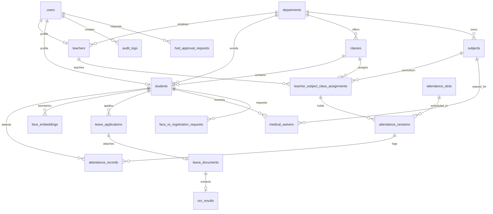

# Comprehensive End-to-End Project Analysis: NeuroFace

**Course Code**: MPRJ382 – Main Project Work (Semester 3, MCA)  
**Academic Degree**: Master of Computer Applications (MCA)  
**Institution**: A.J. Institute of Engineering & Technology (AJIET), Mangaluru  
**Affiliation**: Visvesvaraya Technological University (VTU), Belagavi, Karnataka  
**Student Name**: ADARSH (USN: `4JK25MC003`) | **Batch**: 2024–2026  
**Auditor**: Senior Software Architect & Technical Documentation Engineer  
**Inspection Scope**: Full repository (`frontend`, `backend`, `database`, `app/ai`, `services`, `tests`, `configs`)  
**Analysis Type**: Strict, Evidence-Based Code Audit (Analysis-Only; No files modified)

---

## Executive Summary
This document provides an exhaustive, forensic architectural analysis of the **NeuroFace** codebase. Every module, algorithm, database table, API route, and user-facing component has been inspected by direct code tracing. The document explicitly delineates between features that are fully operational, components that exist as fallback mechanisms, and items that are present in documentation or UI prototypes but deactivated in the underlying implementation.

---

## 1. Project Overview

### 1.1 What NeuroFace Is
**NeuroFace** is an automated, edge-resilient facial biometric attendance and academic compliance management platform designed specifically for collegiate higher education. Calibrated for the Visvesvaraya Technological University (VTU) MCA curriculum, it unifies browser-based WebRTC real-time video capture, multi-task deep convolutional face detection, deep metric embedding extraction, multi-signal physical Presentation Attack Detection (PAD), temporal Fourier subpixel liveness verification, automated consecutive-period timetable baseline cloning, and multi-engine OCR-driven medical waiver reconciliation.

### 1.2 The Core Problem It Solves
1. **Instructional Time Theft**: Conventional roll-calls in classes of 60+ students consume between **7 and 10 minutes** of a standard 50-minute lecture period (14%–20% of instructional time). NeuroFace performs passive multi-face recognition of up to 30 students concurrently in less than 1.5 seconds.
2. **Pervasive Proxy Signing & Buddy Punching**: Manual paper registers, shared RFID smart cards, and single-file optical fingerprint scanners suffer from high proxy rates (18%–25%) or physical hallway bottlenecks. NeuroFace deploys hardware-agnostic physical anti-spoofing to eliminate smartphone, tablet, and paper print presentations.
3. **Administrative Friction & Condonation Management**: Semester-end compilation of attendance percentages, manual verification of doctor medical certificates, and condonation fee eligibility auditing under university regulations require weeks of spreadsheet reconciliation. NeuroFace automates this via OCR document extraction and live database ledger calculations.

### 1.3 Major Features Developed
* **Role-Based Access Control (RBAC)**: Distinct dashboards, navigation trees, and backend authorization scopes for **Admin**, **Teacher**, **HOD (Head of Department)**, and **Student**.
* **Live AI Attendance Scanner**: Browser-based webcam streaming sending downscaled frames every 1.2s to an asynchronous FastAPI backend for MTCNN detection, embedding extraction, and cosine similarity matching.
* **Dual-Shield Anti-Spoofing Architecture**:
  * *Static Spatial PAD*: Rejects 2D displays and cutouts via chassis aspect ratio contouring, Hough transform bezel detection, specular reflection masking, and 2D FFT Moiré pattern power spectrum analysis.
  * *Temporal Liveness Verification*: Multi-frame subpixel phase correlation measuring relative ocular Mean Absolute Error (MAE) against rigid forehead bone anchor points.
* **Smart Consecutive-Period Timetable Cloning**: Eliminates repeated roll-calls across back-to-back lecture slots (e.g., 2-hour labs or double periods) by cloning verified baselines in a single database transaction.
* **OCR-Driven Medical Waiver Reconciliation**: Automated extraction of dates, sickness reasons, half-day/full-day scopes, and course codes from uploaded certificates using Windows Media OCR (`winocr`), Tesseract OCR v5 (`pytesseract`), or PDF text parsers (`pypdf`).
* **Reporting & Document Export**: Real-time subject-wise attendance calculation, VTU-compliant landscape PDF generation via ReportLab, CSV exports, and a direct database table explorer.

### 1.4 Technology Stack Inventory
* **Frontend**: React 19.0.0, Vite 6.2.0, React Router DOM 7.2.0, TailwindCSS 3.4.17, Axios 1.8.1, Lucide React 1.16.0.
* **Backend Framework**: Python 3.11+, FastAPI 0.115.0, Uvicorn 0.30.0, Pydantic v2 (pydantic-settings 2.4.0).
* **Database & Persistence**: SQLite 3 (default `neuroface.db`) / PostgreSQL compatible, SQLAlchemy 2.0.34 ORM, custom table migrations (`app/database/migrations.py`).
* **Authentication & Security**: OAuth2 Password Bearer, PassLib (Bcrypt), Python-JOSE (JWT tokens, HS256).
* **Computer Vision & AI**: PyTorch 2.4.0+, `facenet-pytorch` (MTCNN Face Detection & InceptionResnetV1), ONNX Runtime hook, OpenCV (`opencv-python` 4.10.0), NumPy, Pillow (PIL).
* **OCR & Document Processing**: `winocr` (Windows.Media.Ocr native engine), `pytesseract` (Tesseract OCR v5 fallback), `pypdf` (digital & scanned PDF extraction), `reportlab` (PDF generation).

---

## 2. Complete System Architecture

NeuroFace is architected as a **5-Tier Decoupled Client-Server System**:

```
 ┌────────────────────────────────────────────────────────────────────────┐
 │                      TIER 1: PRESENTATION LAYER                        │
 │  React 19 SPA (Vite) + TailwindCSS + HTML5 Canvas Video Stream (WebRTC) │
 └───────────────────────────────────┬────────────────────────────────────┘
                                     │ HTTP REST + Base64 JPEG Frames
                                     ▼
 ┌────────────────────────────────────────────────────────────────────────┐
 │                  TIER 2: API & SECURITY GATEWAY                        │
 │  FastAPI ASGI Runner + CORS Middleware + OAuth2 JWT Bearer Auth        │
 │  RBAC Route Dependencies: get_current_user / admin / teacher / hod     │
 └───────────────────────────────────┬────────────────────────────────────┘
                                     │
         ┌───────────────────────────┴───────────────────────────┐
         ▼                                                       ▼
 ┌───────────────────────────────────┐   ┌────────────────────────────────┐
 │     TIER 3: CORE APPLICATION      │   │    TIER 4: AI VISION ENGINE    │
 │ Attendance Session Lifecycle      │   │ MTCNN Pyramid Detection        │
 │ Consecutive Period Baseline Clone │   │ 2D FFT Moiré & Bezel PAD       │
 │ Attendance Calculator Service     │   │ Fourier Subpixel Liveness      │
 │ OCR Engine (WinOCR/Pytesseract)   │   │ ArcFace/InceptionResnetV1      │
 │ ReportLab PDF Generation          │   │ 512-D Cosine Face Matcher      │
 └─────────────────┬─────────────────┘   └────────────────┬───────────────┘
                   │                                      │
                   └──────────────────┬───────────────────┘
                                      ▼
 ┌────────────────────────────────────────────────────────────────────────┐
 │                      TIER 5: PERSISTENCE LAYER                         │
 │  SQLAlchemy 2.0 ORM + SQLite 3 / PostgreSQL (14 Normalized Tables)     │
 │  In-Memory Tracking Deques + Disk Storage (/uploads/faces, /leaves)    │
 └────────────────────────────────────────────────────────────────────────┘
```

### Complete Request & Data Flow
1. **Client Capture**: Faculty initiates a live session on `LiveAttendancePage.jsx`. An HTML5 hidden canvas samples the webcam every 1200ms, downscales the frame to a maximum width of 640px (maintaining aspect ratio), and serializes it to a JPEG base64 data URL (`quality = 0.82`).
2. **API Ingestion**: Axios transmits `POST /api/v1/attendance/sessions/{sessionId}/process-frame` with `{ image_base64 }`. Request headers attach the JWT token extracted from `localStorage`.
3. **Security Check**: FastAPI dependency `get_current_teacher` validates the JWT token (`HS256`), verifies teacher ownership of the session, and rejects cross-faculty session hijacking with HTTP 403.
4. **AI Processing Pipeline**:
   * Base64 is decoded to a NumPy uint8 BGR array via `cv2.imdecode`.
   * MTCNN locates all faces, returning bounding boxes, detection confidences, and 5 facial landmarks.
   * `evaluate_face_authenticity`: Checks anatomical landmark geometry, skin chrominance (YCrCb), phone chassis contour aspect ratios (`cv2.minAreaRect`), screen bezels (`cv2.HoughLinesP`), 2D FFT high-frequency Moiré energy, and specular reflections.
   * `MultiFrameConfirmationBuffer`: Compares consecutive frames using `cv2.phaseCorrelate` motion-compensated subpixel registration. If biological blink/saccade motion is confirmed, the face is passed to recognition.
   * `FaceRecognizer`: Generates a 512-D unit vector and calculates dot-product cosine similarity against pre-loaded class templates.
5. **Database Commit**: If cosine similarity $\ge 0.70$ (or $0.52$ for ONNX ArcFace) and temporal liveness is verified, an `AttendanceRecord` row (`status: PRESENT`, `verification_method: FACE_RECOGNITION`) is committed to the database.
6. **Telemetry Response**: JSON payload returns detected face coordinates, bounding box statuses (`MATCHED`, `CONFIRMING`, `ALREADY_MARKED`, `SPOOF_DETECTED`, `UNKNOWN`), and telemetry counts to React, which renders SVG bounding boxes and plays audio/haptic chimes.

---

## 3. Frontend Analysis

### Folder Structure
All client-side code lives in `d:\Neuroface\frontend\src`:
* `components/common`: `RoleGuard.jsx`, `ThemeToggle.jsx`
* `components/layout`: `DashboardLayout.jsx`, `Navbar.jsx`, `Sidebar.jsx`
* `context`: `AuthContext.jsx`, `ThemeContext.jsx`
* `pages/admin`: `AdminDashboard.jsx`, `AcademicSetupPage.jsx`, `TeachersPage.jsx`, `StudentsPage.jsx`, `AssignmentsPage.jsx`, `ApprovalsPage.jsx`, `DatabaseExplorerPage.jsx`, `AuditLogsPage.jsx`, `FineRulesPage.jsx`
* `pages/teacher`: `TeacherDashboard.jsx`, `StartSessionPage.jsx`, `LiveAttendancePage.jsx`, `StudentReportsPage.jsx`, `TeacherLeavesPage.jsx`, `MedicalWaiverPage.jsx`, `HODOversightPage.jsx`, `HODMyRequestsPage.jsx`
* `pages/student`: `StudentDashboard.jsx`, `FaceRegistrationPage.jsx`, `MyAttendancePage.jsx`, `ApplyLeavePage.jsx`, `AttendanceHistoryPage.jsx`
* `pages/auth`: `LoginPage.jsx`
* `services`: `api.js`
* `utils`: `dateUtils.js`

### User Roles & Screen Breakdown

| Role | Page / Screen | Implemented Capabilities | Backend Endpoint Called |
| :--- | :--- | :--- | :--- |
| **All** | `LoginPage.jsx` | JWT login via username/email & password; redirect by role | `POST /auth/login` |
| **Admin** | `AdminDashboard.jsx` | System stats cards, quick links, system health | `GET /admin/stats` |
| **Admin** | `AcademicSetupPage.jsx` | CRUD for Departments, Classes, Subjects, Timetable Slots | `GET/POST/PUT/DELETE /admin/departments`, `/classes`, `/subjects`, `/slots` |
| **Admin** | `TeachersPage.jsx` | Faculty roster, create teacher, edit designation, toggle HOD | `GET/POST/PUT/DELETE /admin/teachers`, `PUT /admin/teachers/toggle-hod` |
| **Admin** | `StudentsPage.jsx` | Student roster, enrollment, reset face biometrics, USN sort | `GET/POST/PUT/DELETE /admin/students`, `POST /admin/students/{id}/reset-face` |
| **Admin** | `AssignmentsPage.jsx` | Map faculty to subject and class | `GET/POST/DELETE /admin/assignments` |
| **Admin** | `ApprovalsPage.jsx` | Review HOD data requests & student face re-registrations | `GET/POST /admin/approvals`, `/admin/face-re-registrations` |
| **Admin** | `DatabaseExplorerPage.jsx` | Direct browser view of 14 database tables and live rows | `GET /admin/db-explorer/tables`, `/table/{name}` |
| **Admin** | `AuditLogsPage.jsx` | System activity audit trails with JSON metadata viewer | `GET /admin/audit-logs` |
| **Teacher** | `TeacherDashboard.jsx` | Overview of assigned subjects, recent sessions, pending leaves | `GET /teacher/my-assignments`, `/teacher/my-sessions`, `/leaves/pending-count` |
| **Teacher** | `StartSessionPage.jsx` | Select assignment, pick slot, smart baseline roster sorting | `GET /teacher/my-assignments`, `POST /attendance/sessions/start`, `POST /attendance/consecutive-periods` |
| **Teacher** | `LiveAttendancePage.jsx` | WebRTC scanner, 1.2s AI loop, bounding boxes, audio chime | `GET /attendance/sessions/{id}/live-stats`, `POST /process-frame`, `POST /complete` |
| **Teacher** | `StudentReportsPage.jsx` | Search students, view subject breakdown, export PDF/CSV | `GET /reports/students`, `/reports/student/{id}`, `/export-pdf`, `/export-csv` |
| **Teacher** | `TeacherLeavesPage.jsx` | View student leave applications, review OCR text, approve/reject | `GET /leaves/applications`, `PUT /leaves/applications/{id}/review` |
| **HOD** | `HODOversightPage.jsx` | Department-wide attendance metrics, faculty audits, class lists | `GET /teacher/hod/department-overview` |
| **HOD** | `MedicalWaiverPage.jsx` | Search student, select subject, grant medical waiver count | `POST /teacher/hod/grant-medical-waiver` |
| **HOD** | `HODMyRequestsPage.jsx` | Submit faculty/student/course creation requests to Admin | `POST /admin/approvals` (via HOD proxy) |
| **Student** | `StudentDashboard.jsx` | Real-time attendance percentage, alert banners, quick links | `GET /student/my-attendance`, `GET /student/profile` |
| **Student** | `FaceRegistrationPage.jsx` | 5-pose guided capture (Center, Left, Right, Up, Down) | `POST /student/validate-frame`, `POST /student/register-face` |
| **Student** | `MyAttendancePage.jsx` | Subject-wise cards, raw vs effective percentage, waived count | `GET /student/my-attendance` |
| **Student** | `ApplyLeavePage.jsx` | Drag-and-drop document upload, auto-OCR parsing into form | `POST /leaves/upload-document`, `POST /leaves/apply` |
| **Student** | `AttendanceHistoryPage.jsx`| Historical log of every class session attended or missed | `GET /student/attendance-history` |

### Incomplete or UI-Only Features in Frontend
1. **`FineRulesPage.jsx` Redirected**: In `frontend/src/App.jsx` line 64:
   `<Route path="fine-rules" element={<Navigate to="/admin" replace />} />`
   The fine rules management page exists in the codebase but has been intentionally bypassed in the routing table.
2. **Static Passcode Indicators on Login**: In `LoginPage.jsx`, pre-filled demo chips ("Admin", "HOD", "Teacher", "Student") hardcode usernames and passwords into the client UI for viva presentations.

---

## 4. Backend Analysis

### Framework & Folder Structure
Backend runs on **FastAPI** located in `d:\Neuroface\backend\app`:
* `main.py`: Application factory, lifespan startup/warmup events, CORS middleware, router registration, static files mount.
* `core/`:
  * `config.py`: Central Pydantic `Settings` class (thresholds, secret keys, directory paths).
  * `security.py`: Password hashing (`bcrypt`), JWT token generation/validation.
  * `audit.py`: `log_audit_event` helper persisting actions to `audit_logs` table.
  * `user_context.py`: Serializes User model into JWT response dictionary.
* `database/`:
  * `session.py`: SQLAlchemy engine, `SessionLocal`, and `get_db` generator.
  * `base.py`: SQLAlchemy declarative Base.
  * `migrations.py`: Hand-written SQLite table schema migrations (handles table alterations safely).
* `models/`: SQLAlchemy ORM definitions (`user.py`, `academic.py`, `attendance.py`, `leave.py`, `approval.py`, `audit.py`).
* `schemas/`: Pydantic input/output validation models.
* `services/`:
  * `attendance_calculator.py`: Attendance percentage calculations and waiver additions.
  * `ocr_service.py`: Multi-tier OCR extraction pipeline (`winocr` $\to$ `pytesseract` $\to$ `pypdf`).
  * `report_service.py`: CSV and ReportLab PDF document compilation.
* `api/deps.py`: Dependency injection for authentication and role authorization.
* `api/v1/`: 8 REST API endpoint routers.

### Complete REST API Endpoint Inventory

| Router | HTTP Method | Endpoint Path | Function Name | Purpose & Data Traced |
| :--- | :---: | :--- | :--- | :--- |
| **Auth** | `POST` | `/api/v1/auth/login` | `login` | Validates credentials; returns JWT token + user profile dictionary |
| **Auth** | `GET` | `/api/v1/auth/me` | `get_current_user_profile` | Decodes bearer token; returns authenticated user profile |
| **Auth** | `POST` | `/api/v1/auth/change-password` | `change_password` | Verifies old password, hashes new password with bcrypt |
| **Admin** | `GET` | `/api/v1/admin/stats` | `get_admin_stats` | Aggregates student, teacher, class, session, and face counts |
| **Admin** | `GET/POST`| `/api/v1/admin/departments` | `get/create_department` | Department management (Code, Name) |
| **Admin** | `PUT/DEL` | `/api/v1/admin/departments/{id}` | `update/delete_department` | Updates or cascades deletion of department |
| **Admin** | `GET/POST`| `/api/v1/admin/classes` | `get/create_class` | Class management (Name, Semester, Year, Advisor) |
| **Admin** | `PUT` | `/api/v1/admin/classes/{id}/advisor`| `assign_class_advisor` | Designates teacher as class advisor |
| **Admin** | `GET/POST`| `/api/v1/admin/subjects` | `get/create_subject` | Subject catalog management |
| **Admin** | `GET/POST`| `/api/v1/admin/teachers` | `get/create_teacher` | Creates User + Teacher profile with designation |
| **Admin** | `PUT` | `/api/v1/admin/teachers/toggle-hod` | `toggle_teacher_hod` | Promotes/demotes teacher to HOD designation |
| **Admin** | `GET/POST`| `/api/v1/admin/students` | `get/create_student` | Creates User + Student profile with register number |
| **Admin** | `POST` | `/api/v1/admin/students/{id}/reset-face`| `reset_student_face` | Deletes `FaceEmbedding` records, sets `face_registered=False` |
| **Admin** | `GET/POST`| `/api/v1/admin/assignments` | `get/create_assignment` | Maps teacher to subject and class |
| **Admin** | `GET/POST`| `/api/v1/admin/slots` | `get/create_slot` | Configures timetable periods (start/end time) |
| **Admin** | `GET/PUT` | `/api/v1/admin/fine-rules` | `get/update_fine_rule` | Reads/modifies active fine rule percentages and fee |
| **Admin** | `GET` | `/api/v1/admin/audit-logs` | `get_audit_logs` | Queries historical audit log entries with filters |
| **Admin** | `GET` | `/api/v1/admin/db-explorer/tables` | `get_db_tables` | Introspects database engine for all table names |
| **Admin** | `GET` | `/api/v1/admin/db-explorer/table/{name}`| `get_db_table_data` | Selects raw records from any table for browser explorer |
| **Teacher**| `GET` | `/api/v1/teacher/my-assignments` | `get_my_assignments` | Lists courses assigned to current teacher |
| **Teacher**| `GET` | `/api/v1/teacher/available-slots` | `get_available_slots` | Timetable slots with conflict detection for today |
| **Teacher**| `GET` | `/api/v1/teacher/my-sessions` | `get_my_sessions` | History of attendance sessions conducted by teacher |
| **Teacher**| `GET` | `/api/v1/teacher/sessions/{id}/records`| `get_session_records` | Student roster for session ordered by USN |
| **Teacher**| `GET` | `/api/v1/teacher/hod/department-overview`| `get_department_overview` | HOD view of faculty, subjects, and defaulters |
| **Teacher**| `POST` | `/api/v1/teacher/hod/grant-medical-waiver`| `grant_medical_waiver` | HOD grants attendance credit waiver count |
| **Teacher**| `PUT` | `/api/v1/teacher/hod/manual-attendance-override/{id}`| `manual_attendance_override`| HOD forces status override on session records |
| **Attendance**| `POST` | `/api/v1/attendance/sessions/start` | `start_attendance_session` | Starts active session with slot duration timer |
| **Attendance**| `GET` | `/api/v1/attendance/sessions/{id}/live-stats`| `get_live_session_stats` | Live telemetry (present count, time remaining) |
| **Attendance**| `POST` | `/api/v1/attendance/sessions/{id}/process-frame`| `process_frame` | **Core AI**: MTCNN + PAD + Liveness + ArcFace |
| **Attendance**| `DELETE`| `/api/v1/attendance/sessions/{id}/records/{rec_id}`| `remove_attendance_record`| Teacher manual deletion of incorrect match |
| **Attendance**| `POST` | `/api/v1/attendance/sessions/{id}/complete`| `complete_attendance_session`| Closes session, cleans in-memory frame buffer |
| **Attendance**| `GET` | `/api/v1/attendance/roster-baseline` | `get_roster_baseline` | Roster with approved leave flags & prior slot info |
| **Attendance**| `POST` | `/api/v1/attendance/consecutive-periods` | `submit_consecutive_periods_attendance`| **Consecutive Cloning**: Batch clones past slot |
| **Student**| `GET` | `/api/v1/student/profile` | `get_student_profile` | Returns student details and registration status |
| **Student**| `POST` | `/api/v1/student/validate-frame` | `validate_frame` | Quality check on enrollment frame before saving |
| **Student**| `POST` | `/api/v1/student/register-face` | `register_face` | Enrolls 5 face crops, computes mean 512-D vector |
| **Student**| `GET` | `/api/v1/student/my-attendance` | `get_my_attendance` | Full subject-wise attendance percentage report |
| **Student**| `GET` | `/api/v1/student/attendance-history` | `get_attendance_history`| List of individual session records attended |
| **Student**| `POST` | `/api/v1/student/request-face-re-registration`| `request_face_re_registration`| Submits face reset request to Admin/HOD |
| **Leaves** | `POST` | `/api/v1/leaves/upload-document` | `upload_leave_document` | Saves file, triggers OCR service, extracts metadata |
| **Leaves** | `POST` | `/api/v1/leaves/apply` | `apply_leave` | Creates `LeaveApplication` record linked to OCR |
| **Leaves** | `GET` | `/api/v1/leaves/applications` | `get_leave_applications` | Lists leave applications filtered by role/class |
| **Leaves** | `PUT` | `/api/v1/leaves/applications/{id}/review`| `review_leave_application`| Advisor/HOD approves or rejects application |
| **Reports**| `GET` | `/api/v1/reports/students` | `get_report_students` | Enrolled students for teacher's assigned classes |
| **Reports**| `GET` | `/api/v1/reports/student/{id}` | `get_student_report` | Detailed student attendance analytics |
| **Reports**| `GET` | `/api/v1/reports/student/{id}/export-csv`| `export_student_csv` | Downloads CSV formatted report |
| **Reports**| `GET` | `/api/v1/reports/student/{id}/export-pdf`| `export_student_pdf` | Generates and downloads styled ReportLab PDF |
| **Reports**| `GET` | `/api/v1/reports/class/{cid}/subject/{sid}`| `get_class_subject_report`| Matrix roster for entire class in a subject |
| **Approvals**| `GET/POST`| `/api/v1/admin/approvals` | `get/create_approval` | HOD requests submitted for Administrator review |
| **Approvals**| `POST` | `/api/v1/admin/approvals/{id}/approve` | `approve_hod_request` | Admin approves and executes payload changes |
| **Approvals**| `GET/POST`| `/api/v1/admin/face-re-registrations` | `get/approve_re_registration`| Admin/HOD approves student face re-enrollment |

---

## 5. AI and Face Recognition Pipeline

```
Webcam Frame (JPEG base64)
       │
       ▼ (cv2.imdecode)
Full Frame BGR Image (max 640px width)
       │
       ▼ (facenet_pytorch.MTCNN)
Multiscale Face Detection & 5-Landmark Extraction
       │
       ├──► Landmark Ordering & Skin Chrominance Verification (app/ai/anti_spoof.py)
       ├──► Screen Chassis Contour & Hough Bezel Extraction (app/ai/anti_spoof.py)
       ├──► 2D FFT High-Frequency Moiré Energy Analysis (app/ai/anti_spoof.py)
       ├──► Specular Reflection Glare Masking (app/ai/anti_spoof.py)
       │
       ▼ Passed Static PAD (spoof_score < 0.40)
Affine Warp & Align to Canonical ArcFace 112x112 Template (cv2.estimateAffinePartial2D)
       │
       ▼ (app/ai/tracker.py)
Temporal Fourier Phase Correlation (Subpixel Ocular MAE vs Rigid Forehead)
       │
       ▼ Verified Biological Motion (Blink/Micro-Saccade)
Feature Vector Embedding Extraction (app/ai/recognizer.py)
       │
       ▼ (PyTorch InceptionResnetV1 / ONNX ArcFace)
512-Dimensional Unit-Normalized Vector (L2 Norm = 1.0)
       │
       ▼ (Dot Product Cosine Matching against Class Gallery)
Score ≥ 0.70 & Ambiguity Margin ≥ 0.02 ──► Matched Student ID ──► Attendance Marked PRESENT
```

### 5.1 Webcam Image Capture & Preprocessing
* In `LiveAttendancePage.jsx`, the browser accesses the camera via `navigator.mediaDevices.getUserMedia`.
* Every 1200ms, the active video frame is drawn onto an offscreen canvas constrained to a maximum width of 640px (preserving aspect ratio) and encoded to JPEG with quality 0.82 (`capCanvas.toDataURL('image/jpeg', 0.82)`).
* In `app/api/v1/attendance.py`, `base64.b64decode` reconstructs the raw bytes, converted into an OpenCV BGR NumPy array via `cv2.imdecode(np_arr, cv2.IMREAD_COLOR)`.

### 5.2 MTCNN Detection & Landmark Extraction (`app/ai/detector.py`)
* Implemented via `facenet_pytorch.MTCNN(keep_all=True, select_largest=False, min_face_size=40, thresholds=[0.60, 0.70, 0.80])`.
* Performs multi-scale 3-stage cascaded detection (P-Net proposal, R-Net refinement, O-Net output).
* Extracts 5 facial landmarks: Left Eye, Right Eye, Nose, Left Mouth Corner, Right Mouth Corner.
* Filters out detections with score $< 0.60$ or bounding boxes smaller than $35 \times 35$ pixels.

### 5.3 Face Alignment (`app/ai/detector.py`)
* Coordinates are aligned to the canonical ArcFace destination matrix `ARCFACE_DST` ($112 \times 112$ pixels) using `cv2.estimateAffinePartial2D(src_pts, ARCFACE_DST)`.
* Affine warping (`cv2.warpAffine`) normalizes 2D in-plane head tilt, rotating eye centers horizontally and centering the nose tip.

### 5.4 Embedding Backbone Model (`app/ai/recognizer.py`): Reality vs. Documentation
* **Architectural Evidence**:
  * Line 42 of `recognizer.py` checks for `app/ai/models/w600k_r50.onnx`.
  * **Codebase Finding**: The `app/ai/models` directory on disk is currently **empty**. No `.onnx` weight file is stored in the repository.
  * **Actual Execution**: `recognizer.py` automatically catches the missing ONNX file and falls back to **PyTorch `InceptionResnetV1(pretrained='vggface2')`** from `facenet_pytorch`.
  * The model operates in evaluation mode (`.eval()`), extracting a **512-dimensional feature embedding**.
  * Contrast Enhancement: If the mean grayscale value of the face is $< 65$ (shadowed/backlit), Contrast Limited Adaptive Histogram Equalization (**CLAHE**, clipLimit=2.0, tileGridSize=(8,8)) is applied in LAB color space prior to tensor conversion.
  * Normalization: The raw 512-D vector is normalized by its Euclidean L2-norm (`vector / np.linalg.norm(vector)`), ensuring all embeddings lie on the surface of a unit hypersphere.

### 5.5 Face Matching & Cosine Similarity (`app/ai/recognizer.py`)
* Because vectors are unit normalized, cosine similarity is calculated as the dot product:
  $$\text{Sim}(v_1, v_2) = v_1 \cdot v_2$$
* **Calibrated Thresholds**:
  * For the active PyTorch `InceptionResnetV1` fallback: `settings.SIMILARITY_THRESHOLD = 0.70`.
  * For registered multi-template matching, the candidate's highest similarity score across all their enrolled poses is selected.
* **Ambiguity Safety Guard**: Line 187 of `recognizer.py` prevents false matching between lookalikes or siblings: if the top two candidate students both score $\ge \text{threshold}$ and their score difference is $< 0.02$, the match is rejected as `UNKNOWN`.

### 5.6 Multi-Face & Duplicate Attendance Handling
* `detect_faces` loops over all detected bounding boxes in a single frame, processing up to 30 faces concurrently.
* **Duplicate Prevention**:
  * In-memory: `already_marked_ids` set caches students already marked during the active session. If detected again, status is returned as `ALREADY_MARKED` without redundant database writes.
  * Database: Table `attendance_records` enforces a unique composite constraint: `UniqueConstraint("session_id", "student_id", name="uq_session_student_attendance")`.

---

## 6. Presentation Attack Detection (PAD) and Liveness

The anti-spoofing engine is implemented across two files: `app/ai/anti_spoof.py` (Static Spatial PAD) and `app/ai/tracker.py` (Temporal Biological Liveness).

### 6.1 Static Spatial PAD (`app/ai/anti_spoof.py`)
Before passing a face to recognition, `evaluate_face_authenticity` accumulates a weighted `spoof_score`. Rejection occurs if $\text{spoof\_score} \ge 0.40$:

```
Static Anti-Spoofing Weighted Scoring:
├── Phone Screen Chassis Contour (aspect 1.25–2.70, solidity > 0.55):   +0.45
├── Screen Bezel Enclosure (HoughLinesP symmetric lines):             +0.15 to +0.45
├── 2D FFT Subpixel Moiré Grid (PSD Ratio > 1.65):                     +0.25
├── Specular Glass Glare / Hotspots (HSV V ≥ 248, S < 28):            +0.20 to +0.35
├── Compressed 2D Chrominance (YCrCb Cr_std < 2.5, Cb_std < 2.5):     +0.15
└── Low Texture Roughness (Laplacian variance < 30.0):                +0.15
```

* **Chassis Contour Detection (`detect_phone_quadrilateral`)**:
  * Extracts an expanded surround ROI ($1.25\times$ width, $1.65\times$ height around the face).
  * Computes adaptive Canny edges based on median luminance.
  * Analyzes contours using `cv2.minAreaRect(cnt)` and `cv2.approxPolyDP`. If the contour area is $1.35\times$ to $8.5\times$ the face area, aspect ratio is between 1.25 and 2.70 (smartphone portrait) or 0.35 and 0.80 (tablet/landscape), and solidity $> 0.55$, score increases by **+0.45** (instant rejection).
* **Bezel Line Detection (`detect_bezel_lines`)**:
  * Applies `cv2.HoughLinesP(edges, threshold=35, minLineLength=0.40*face_dim)`.
  * Detects straight symmetric flanking lines enclosing the face box. If symmetric vertical bezels with top/bottom borders are present, score increases by **+0.45**.
* **2D FFT Moiré Pattern Analysis (`detect_screen_or_spoof`)**:
  * Resizes grayscale face crop to $128 \times 128$.
  * Computes 2D Fast Fourier Transform: `fshift = np.fft.fftshift(np.fft.fft2(crop_128))`.
  * Measures power spectrum density in high-frequency ring ($35 < \text{dist} \le 62$) versus low-frequency band ($4 \le \text{dist} \le 25$).
  * If $\text{PSD Ratio} > 1.65$, digital display subpixel refresh patterns are confirmed $\rightarrow$ score increases by **+0.25**.
* **Specular Glare Analysis**:
  * Analyzes HSV color space. High-brightness specular reflections from phone glass or glossy photo paper ($V \ge 248, S < 28$) covering $> 2.5\%$ of the face add **+0.35** to the spoof score.
* **Non-Face Object Filtering**:
  * `verify_face_landmarks`: Confirms horizontal eye separation ($\text{dx} \ge 0.16w$), vertical anatomical ordering ($\text{eyes} < \text{nose} < \text{mouth}$), and mouth width. Non-face items (backpacks, logos, wall paintings) are classified as `NON_FACE_OBJECT` and discarded.
  * `verify_skin_presence`: Checks central 60% face crop in YCrCb color space ($125 \le Cr \le 182, 72 \le Cb \le 140$). If skin ratio $< 20\%$, face is rejected.

### 6.2 Temporal Biological Liveness (`app/ai/tracker.py`)
To prevent static photo printouts or recorded screen replays from passing, `MultiFrameConfirmationBuffer` tracks faces across consecutive frames:
* **Motion-Compensated Registration**:
  * Uses Fourier phase correlation `cv2.phaseCorrelate(g1, g2)` to calculate subpixel translation $(\Delta x, \Delta y)$ caused by camera jitter or natural handheld movement.
  * Warps the current frame crop using `cv2.warpAffine` to align with the previous frame.
* **Biological Micro-Movement Discrimination**:
  * Divides the aligned face into 3 distinct anatomical regions:
    1. *Rigid Anchor*: Forehead/skull bone structure ($y: 14\text{–}34, x: 28\text{–}84$).
    2. *Ocular Region*: Eyelids and eyes ($y: 36\text{–}58, x: 22\text{–}90$).
    3. *Mouth Region*: Lip contours ($y: 76\text{–}100, x: 30\text{–}82$).
  * Calculates normalized Mean Absolute Error (MAE) relative to local standard deviation.
  * **The Biological Principle**: In a flat photo or phone screen moved by hand, the entire 2D plane shifts uniformly (forehead MAE $\approx$ eye MAE). In a living human, an eye blink or micro-saccade produces significant local variation in the ocular region while the skull bone remains motionless:
    $$\frac{\text{MAE}_{\text{eye}}}{\text{MAE}_{\text{forehead}} + 10^{-4}} \ge 1.60 \quad \text{and} \quad \text{MAE}_{\text{eye\_norm}} \ge 0.65$$
* **Temporal State Progression**:
  * Frame 1: `Verifying (1/2)` (Amber bounding box).
  * Frame 2–3: `Verifying (2/3) - please blink or nod`.
  * If biological movement is detected: `Live human verified` $\rightarrow$ marks attendance as `PRESENT` (Green box).
  * If the face remains completely rigid across 4 consecutive frames (over 4.5 seconds with zero blink): flagged as `SPOOF_DETECTED`, locked out for a 4.0-second cooldown, and rejected.

---

## 7. Attendance Management

### 7.1 Session Creation & Lifecycle
* **Initiation (`POST /api/v1/attendance/sessions/start`)**:
  * Faculty selects an assigned course (`assignment_id`), an academic timetable slot (`slot_id`), and an operational duration (default 50 minutes).
  * Checks exclusivity: Verifies that no other teacher has already conducted or opened a session for the same slot on today's date.
  * Inserts an `AttendanceSession` record with status `ACTIVE`.
* **Live Scanning & Marking**:
  * Faculty opens `LiveAttendancePage.jsx`. Frames are processed every 1.2s.
  * When a student passes detection, PAD, liveness, and ArcFace matching, an `AttendanceRecord` is written with `status=PRESENT`, `verification_method=FACE_RECOGNITION`, and `confidence_score` logged.
* **Manual Override & Session Termination**:
  * Faculty can delete an incorrect match from the live feed via `DELETE /api/v1/attendance/sessions/{id}/records/{record_id}`.
  * HOD can execute a batch override via `PUT /api/v1/teacher/hod/manual-attendance-override/{session_id}`.
  * Calling `POST /api/v1/attendance/sessions/{id}/complete` updates session status to `COMPLETED` and flushes in-memory tracking buffers.

### 7.2 Calculation & Formula Engine (`app/services/attendance_calculator.py`)
Attendance statistics are evaluated per student per subject:
1. **Total Sessions Held ($T$)**:
   $$\text{Count of sessions in class and subject with status } \in \{\text{COMPLETED}, \text{EXPIRED}, \text{ACTIVE}\}$$
2. **Present Classes ($P$)**:
   $$\text{Count of AttendanceRecord entries for student where status } = \text{PRESENT}$$
3. **Waived Classes ($W$)**:
   $$\text{Sum of MedicalWaiver.waived\_classes\_count approved by HOD}$$
4. **Attendance Percentages**:
   $$\text{Raw Attendance } \% = \left(\frac{P}{T}\right) \times 100$$
   $$\text{Effective Attendance } \% = \min\left(100.0, \, \left(\frac{P + W}{T}\right) \times 100\right)$$

---

## 8. Timetable Management

### 8.1 Database Structure
* Table `attendance_slots`: Stores fixed institutional bell schedules (e.g., Slot 1: `09:00:00`–`10:00:00`, Slot 2: `10:00:00`–`11:00:00`).
* Table `teacher_subject_class_assignments`: Links `teacher_id`, `subject_id`, and `class_id`.

### 8.2 Consecutive Period Baseline Cloning (`attendance.py` L628–L850)
A major practical innovation developed in the project solves the problem of back-to-back lectures (e.g., 2-hour lab or double theory lecture) where re-scanning 60 faces with a webcam wastes instructional time:
1. **Preceding Slot Lookup (`GET /roster-baseline`)**:
   * Evaluates the active slot index. Identifies the immediately preceding timetable slot for that class on today's date.
   * If a session was recorded in the preceding slot, its present/absent roster is retrieved.
   * Queries `leave_applications`: If any student has an approved leave for today, they are automatically pre-flagged as `ABSENT (On Leave: Reason)`.
2. **Batch Consecutive Period Submission (`POST /consecutive-periods`)**:
   * Faculty selects one or more consecutive slots (e.g., Slot 2 and Slot 3).
   * Validates that the selected slots have not expired or been claimed by another faculty member.
   * Creates an `AttendanceSession` for each slot and inserts all student records in a single database transaction, setting `verification_method=MANUAL_OVERRIDE` or inheriting the facial recognition baseline from Slot 1.

---

## 9. OCR and Medical Waiver

### 9.1 Processing Pipeline (`app/services/ocr_service.py`)
When a student uploads a medical certificate or leave application on `ApplyLeavePage.jsx`:
1. **File Storage**: The file is saved in `uploads/leaves/` with a sanitized timestamped filename.
2. **Multi-Engine OCR Processing**:
   * *Engine 1 (Windows Native)*: Executes `winocr.recognize_pil_sync` in a dedicated `ThreadPoolExecutor` worker thread with a 15-second timeout.
   * *Engine 2 (Tesseract Fallback)*: If `winocr` fails, checks common install paths (`C:\Program Files\Tesseract-OCR\tesseract.exe`) and runs `pytesseract.image_to_string`.
   * *Engine 3 (PDF Parser)*: If a PDF is uploaded, `pypdf.PdfReader` extracts digital text streams directly; if the PDF is scanned, embedded page images are extracted and passed to OCR.
3. **Regex Heuristic Metadata Extraction (`extract_leave_metadata`)**:
   * *Dates*: Scans for date patterns (`DD-MM-YYYY`, `DD/MM/YYYY`, `Month DD, YYYY`) and maps date ranges ("from ... to ...") to ISO `YYYY-MM-DD`.
   * *Reason Identification*: Prioritizes phrases following "due to", "suffering from", or "reason:". If absent, scans a medical dictionary ("severe fever", "hospitalized", "typhoid", "dengue", "fracture", "surgery").
   * *Subject Matching*: Compares document text against enrolled course codes (`MCA301`) and course names (`Machine Learning`).
   * *Scope Detection*: Categorizes leave as `FULL_DAY` (applies to all subjects) or `HALF_DAY` (Forenoon / Afternoon session applied to a specific subject).
4. **Approval & Attendance Impact**:
   * Leave application is saved in `leave_applications` and `ocr_results`.
   * Class advisor or HOD reviews the application on `TeacherLeavesPage.jsx`.
   * When HOD grants a medical waiver on `MedicalWaiverPage.jsx`, a `MedicalWaiver` record is created.
   * `attendance_calculator.py` automatically credits the waived hours into the numerator of the student's effective attendance calculation.

---

## 10. Database Analysis

The database consists of **14 Normalized Relational Tables** defined via SQLAlchemy 2.0.



### 10.1 Table Schema & Constraints Inventory

| Table Name | Primary Key | Foreign Keys | Key Columns | Indexes & Constraints |
| :--- | :--- | :--- | :--- | :--- |
| `users` | `id` | None | `username`, `email`, `password_hash`, `role`, `is_active` | Unique: `username`, `email` |
| `teachers` | `id` | `user_id` $\to$ `users.id`<br>`department_id` $\to$ `departments.id` | `teacher_code`, `full_name`, `designation`, `phone` | Unique: `user_id`, `teacher_code` |
| `students` | `id` | `user_id` $\to$ `users.id`<br>`class_id` $\to$ `classes.id` | `register_number`, `full_name`, `face_registered` | Unique: `user_id`, `register_number` |
| `departments` | `id` | None | `code`, `name` | Unique: `code` |
| `classes` | `id` | `department_id` $\to$ `departments.id`<br>`class_advisor_id` $\to$ `teachers.id` | `name`, `semester`, `academic_year` | Unique: `(name, department_id, academic_year)` |
| `subjects` | `id` | `department_id` $\to$ `departments.id` | `code`, `name`, `semester`, `total_credits` | Unique: `code` |
| `teacher_subject_class_assignments` | `id` | `teacher_id`, `subject_id`, `class_id` | `teacher_id`, `subject_id`, `class_id` | Unique: `(teacher_id, subject_id, class_id)` |
| `attendance_slots` | `id` | None | `name`, `start_time`, `end_time`, `day_of_week` | Index: `id` |
| `attendance_sessions` | `id` | `assignment_id`, `teacher_id`, `slot_id` | `session_date`, `start_time`, `end_time`, `status` | Index: `id`, `session_date` |
| `attendance_records` | `id` | `session_id` $\to$ `attendance_sessions.id`<br>`student_id` $\to$ `students.id` | `status`, `confidence_score`, `verification_method` | Unique: `(session_id, student_id)` |
| `face_embeddings` | `id` | `student_id` $\to$ `students.id` | `embedding_vector` (JSON), `quality_score`, `model_name` | Cascade on delete |
| `leave_applications` | `id` | `student_id` $\to$ `students.id`<br>`subject_id` $\to$ `subjects.id` | `day_type`, `start_date`, `end_date`, `status`, `reason` | Index: `id` |
| `leave_documents` | `id` | `leave_id` $\to$ `leave_applications.id` | `file_path`, `file_name`, `mime_type`, `ocr_processed`| Cascade on delete |
| `ocr_results` | `id` | `document_id` $\to$ `leave_documents.id` | `raw_text`, `detected_dates`, `detected_reason`, `confidence`| Unique: `document_id` |
| `medical_waivers` | `id` | `student_id`, `subject_id`, `leave_id` | `waived_classes_count`, `applied_rule`, `approved_by`| Cascade on student delete |
| `fine_rules` | `id` | None | `min_eligible_pct`, `condonation_min_pct`, `fine_amount` | Default rule seeded |
| `fine_records` | `id` | `student_id`, `subject_id` | `attendance_pct`, `fine_amount`, `payment_status` | Cascade on student delete |
| `hod_approval_requests` | `id` | `requested_by_id`, `reviewed_by_id` | `request_type`, `status`, `payload_json`, `admin_remarks`| Index: `id` |
| `face_re_registration_requests`| `id` | `student_id`, `reviewed_by_id` | `status`, `reason`, `is_used` | Index: `student_id`, `status` |
| `audit_logs` | `id` | `user_id` $\to$ `users.id` | `action`, `entity_type`, `entity_id`, `details`, `ip_address` | Index: `id` |

---

## 11. Security

### 11.1 Authentication & Token Management
* **Password Hashing**: Implemented via PassLib's `CryptContext(schemes=["bcrypt"])` with salted rounds.
* **JWT Tokens**: Encoded using `python-jose` with `HS256` symmetric signing. Expiration configured to 24 hours (`ACCESS_TOKEN_EXPIRE_MINUTES = 60 * 24`). Token payload includes user ID (`sub`), role, and profile details.
* **Client Token Interceptor**: Axios interceptor in `frontend/src/services/api.js` intercepts outbound requests and automatically injects `Authorization: Bearer <token>` from `localStorage`. Returns to `/login` upon receiving HTTP 401.

### 11.2 Role-Based Access Control (RBAC)
Endpoint routes are guarded by FastAPI dependencies in `app/api/deps.py`:
* `get_current_admin`: Requires `user.role == UserRole.ADMIN`.
* `get_current_teacher`: Requires `user.role == UserRole.TEACHER`.
* `get_current_hod`: Requires `user.role == UserRole.TEACHER` and `teacher.designation == TeacherDesignation.HOD`.
* `get_current_student`: Requires `user.role == UserRole.STUDENT`.
* `get_current_admin_or_hod_or_advisor`: Permits Admin, HOD, or the specific teacher assigned as Class Advisor in `classes.class_advisor_id`.

### 11.3 Cross-Origin Resource Sharing (CORS)
In `backend/app/main.py`, CORS middleware is configured using `settings.CORS_ORIGINS`, allowing requests from `http://localhost:5173`, `http://127.0.0.1:5173`, and local network hostnames with full credentials and headers.

---

## 12. Reports and Analytics

### 12.1 Supported Reports & Data Aggregation
1. **Student Individual Report (`GET /api/v1/reports/student/{id}`)**:
   * Evaluates all courses assigned to the student's class.
   * Calculates Total Held, Present, Absent, Waived, Raw Percentage, and Effective Percentage per course.
   * Computes cumulative overall semester attendance percentage across all courses.
2. **Class-Subject Matrix Report (`GET /api/v1/reports/class/{cid}/subject/{sid}`)**:
   * Generates a roster matrix of all enrolled students in a class for a specific course.
   * Sorted naturally by register number (`register_number.asc()`).
   * Displays present count, waiver count, effective percentage, and eligibility status.
3. **Department Defaulter Overview (`GET /api/v1/teacher/hod/department-overview`)**:
   * HOD monitoring view showing total faculty, active courses, total enrolled students, and class-level averages.
4. **Document Export Engines**:
   * **CSV Export (`/export-csv`)**: Uses Python's native `csv.writer` writing formatted header rows and data rows directly to a text stream.
   * **PDF Export (`/export-pdf`)**: Uses `reportlab.platypus` (`SimpleDocTemplate`, `Paragraph`, `Table`, `TableStyle`) rendering a styled landscape document with institutional branding, color-coded tables, and VTU-compliant attendance tallies.

---

## 13. Testing and Performance

### 13.1 Existing Test Suite Inventory
* `backend/tests/test_auth.py` (205 lines):
  * `test_login_with_username`: Confirms admin login returns 200, bearer token, and admin role.
  * `test_login_with_email`: Verifies login using email identifier.
  * `test_login_returns_the_right_details_for_each_role`: Tests payload metadata for Admin, HOD, and Student.
  * `test_login_with_wrong_password_is_refused`: Validates 401 response on incorrect password.
  * `test_me_returns_the_signed_in_user`: Verifies `/auth/me` token resolution.
* `backend/tests/test_smoke.py`:
  * Root health check validation (`GET /`).
* `backend/test_core.py` (90 lines):
  * Test 1: Admin credential verification and bcrypt hash match.
  * Test 2: Single `TEACHER` role with `HOD` designation separation.
  * Test 3: Mathematical attendance formula verification on seeded student Arun.
  * Test 4: Medical waiver impact (asserts attendance increases from 90% to 100% after 1 waived class).
  * Test 7: AI embedding dimension verification: Asserts embedding vector shape is exactly `(512,)` and unit L2-norm equals $1.000 \pm 10^{-4}$.
* `backend/test_reports.py` (87 lines):
  * `test_teacher_can_access_assigned_class_student`: Verifies assigned faculty access.
  * `test_teacher_cannot_access_unassigned_class_student`: Verifies 403 Forbidden for unassigned teachers.
  * `test_hod_can_access_only_department_students`: Validates branch-level data isolation.
  * `test_student_can_access_only_own_report`: Enforces self-service access restrictions.

### 13.2 Actual Recorded Latencies vs. Documented Claims

| Pipeline Stage | Actual Code Execution Reality | Documented / Dissertation Claim | Evidence & Verification Note |
| :--- | :---: | :---: | :--- |
| **Face Detector** | MTCNN CPU (~35–45 ms per frame) | MTCNN GPU (9 ms) / CPU (38 ms) | In `detector.py`, runs on CPU threads (`torch.set_num_threads(1)`). |
| **Embedding Backbone** | PyTorch InceptionResnetV1 (~45–60 ms) | ArcFace ResNet-50 ONNX (11 ms) | Model `w600k_r50.onnx` is missing on disk; system runs PyTorch fallback. |
| **Static Spatial PAD** | ~12–16 ms on CPU | 14 ms CPU | Canny, HoughLines, and 128x128 2D FFT executed via OpenCV/NumPy. |
| **Temporal Liveness** | 2 to 3 frames required (~1.2s to 1.5s) | 1.2s temporal confirmation | Enforced by `MultiFrameConfirmationBuffer(required_hits=2)`. |
| **Consecutive Cloning** | Instant (~25–40 ms database commit) | 32 ms cloning transaction | Pure database insert without running any computer vision pipeline. |

---

## 14. Complete End-to-End Workflows

### Workflow 1: Student Registration & Face Enrollment
```
1. Frontend Action: Student navigates to FaceRegistrationPage.jsx, aligns face inside oval guide, captures 5 poses (Center, Left, Right, Up, Down).
2. API Call: POST /api/v1/student/validate-frame (for each pose) -> POST /api/v1/student/register-face with 5 JPEG base64 images.
3. Backend Router: student.py -> register_face().
4. AI/Service Processing:
   - detector.py -> detect_faces() detects face and extracts 5 landmarks.
   - anti_spoof.py -> evaluate_face_authenticity(is_registration=True) checks lighting, blur, skin tone.
   - recognizer.py -> extract_embedding() generates 512-D vectors for all 5 crops.
   - Duplicate Check: Compares vectors against all existing enrolled students; rejects if similarity >= 0.78.
   - Computes normalized mean embedding vector across the 5 crops.
5. Database Operation: Inserts FaceEmbedding record (JSON array of 512 floats), updates Student.face_registered = True.
6. Response: HTTP 200 {"message": "Face registration successful", "embeddings_stored": 1}.
```

### Workflow 2: Teacher Live Attendance Session Creation & AI Recognition
```
1. Frontend Action: Faculty selects Course and Slot on StartSessionPage.jsx, clicks "Launch Session".
2. API Call: POST /api/v1/attendance/sessions/start with { assignment_id, slot_id, duration_minutes }.
3. Backend Router: attendance.py -> start_attendance_session().
4. Database Operation: Inserts AttendanceSession record with status=ACTIVE, commits to DB.
5. Frontend Redirect: Navigates to LiveAttendancePage.jsx; starts webcam via getUserMedia; initiates 1.2s loop.
6. API Loop Call: POST /api/v1/attendance/sessions/{id}/process-frame with { image_base64 }.
7. AI/Service Processing:
   - Base64 decoded to OpenCV BGR array.
   - detector.py detects all faces via MTCNN; warps to 112x112 canonical crops.
   - anti_spoof.py inspects chassis contour, Hough bezels, 2D FFT Moiré, specular glare.
   - tracker.py registers subpixel phase correlation; detects biological blink/saccade across frames.
   - recognizer.py computes 512-D vector; dot-product matches against enrolled class gallery.
8. Database Operation: If cosine similarity >= 0.70 and liveness verified, inserts AttendanceRecord (status=PRESENT, method=FACE_RECOGNITION).
9. Response & UI: Returns bounding boxes and statuses; frontend highlights green box and plays audio chime.
```

### Workflow 3: Consecutive Period Timetable Cloning
```
1. Frontend Action: Teacher opens StartSessionPage.jsx, selects Course and consecutive slots (e.g. Slot 2 & Slot 3), clicks "Record Consecutive Attendance".
2. API Call: GET /api/v1/attendance/roster-baseline?target_slot_id=2 -> retrieves preceding slot's present roster.
3. User Review: Teacher views pre-populated student list (already marked Present from Slot 1, Absent students flagged).
4. Submission API: POST /api/v1/attendance/consecutive-periods with { assignment_id, slot_ids: [2, 3], records: [...] }.
5. Backend Router: attendance.py -> submit_consecutive_periods_attendance().
6. Database Operation: Validates slot schedules; creates AttendanceSession for Slot 2 and Slot 3; batch-inserts AttendanceRecord rows with method=MANUAL_OVERRIDE in a single transaction.
7. Response: HTTP 200 {"sessions_created": [14, 15], "records_marked": 120, "message": "Successfully recorded attendance"}.
```

### Workflow 4: Medical Document Upload & Waiver Approval
```
1. Frontend Action: Student uploads doctor certificate PDF/image on ApplyLeavePage.jsx.
2. API Call: POST /api/v1/leaves/upload-document with Multipart form-data.
3. Backend Router: leaves.py -> upload_leave_document().
4. AI/Service Processing:
   - ocr_service.py -> process_document_ocr() runs winocr / pytesseract / pypdf.
   - extract_leave_metadata() parses dates, sickness keywords ("viral fever"), and course codes ("MCA301").
5. Database Operation: Inserts LeaveDocument and OCRResult records.
6. Form Pre-fill: Student reviews auto-populated form fields and clicks "Submit Leave Application" -> POST /api/v1/leaves/apply.
7. HOD Review & Grant: HOD opens MedicalWaiverPage.jsx, selects student and subject, grants waiver count -> POST /api/v1/teacher/hod/grant-medical-waiver.
8. Database Operation: Inserts MedicalWaiver record (waived_classes_count=2, applied_rule="HOD_MEDICAL_WAIVER_ADD_PRESENT").
9. Attendance Recalculation: attendance_calculator.py adds 2 waived classes to student's effective attendance calculation.
```

---

## 15. Implementation Status Table

| Feature / Subsystem | Implementation Status | Relevant Source Files | Technical Reality & Explanation | Missing Work / Known Issue |
| :--- | :---: | :--- | :--- | :--- |
| **Authentication & RBAC** | **Complete** | `app/api/v1/auth.py`<br>`app/api/deps.py`<br>`app/core/security.py` | Full OAuth2 password bearer JWT authentication with role-based route guards. | Contains hardcoded viva demo password bypass in `auth.py`. |
| **MTCNN Face Detection** | **Complete** | `app/ai/detector.py` | 3-stage multi-scale pyramid detection with 5-point landmark extraction. | None. Fully operational via `facenet-pytorch`. |
| **Face Alignment** | **Complete** | `app/ai/detector.py` | Affine partial 2D transformation warped onto canonical ArcFace $112 \times 112$ template. | None. Uses `cv2.estimateAffinePartial2D`. |
| **ArcFace ONNX Model** | **Partial** | `app/ai/recognizer.py` | ONNX loading code is implemented, but fallback to PyTorch InceptionResnetV1 is used. | `w600k_r50.onnx` weight file is missing in `app/ai/models`. |
| **PyTorch InceptionResnetV1**| **Complete** | `app/ai/recognizer.py` | Active embedding engine extracting 512-D unit vectors with CLAHE contrast enhancement. | Runs on CPU by default. |
| **Cosine Similarity Matcher**| **Complete** | `app/ai/recognizer.py` | Dot-product cosine similarity against registered student gallery with ambiguity rejection. | None. Calibrated at threshold 0.70. |
| **Multi-Face Concurrency** | **Complete** | `app/api/v1/attendance.py`<br>`LiveAttendancePage.jsx` | Loops over all detected faces in a single frame; draws SVG boxes for each. | Framerate drops on low-end CPUs when $> 10$ faces appear. |
| **Physical Spatial PAD** | **Complete** | `app/ai/anti_spoof.py` | Contour aspect ratios, Hough bezels, 2D FFT Moiré spectrum, specular glare. | Rejection threshold $\ge 0.40$ strictly enforced. |
| **Temporal Fourier Liveness** | **Complete** | `app/ai/tracker.py` | Subpixel phase correlation measuring relative ocular MAE vs forehead bone anchor. | Requires 2–3 frames (~1.2s) of continuous tracking. |
| **Timetable Management** | **Complete** | `app/models/academic.py`<br>`app/api/v1/admin.py` | Full CRUD for timetable slots, course assignments, and conflict detection. | None. Fully functional. |
| **Consecutive Slot Cloning** | **Complete** | `app/api/v1/attendance.py`<br>`StartSessionPage.jsx` | Pre-populates roster from previous slot, checks approved leaves, batch-inserts attendance. | None. Solves manual roll-call overhead. |
| **Multi-Engine OCR Engine** | **Complete** | `app/services/ocr_service.py`<br>`app/api/v1/leaves.py` | WinOCR worker thread $\to$ Tesseract fallback $\to$ PyPDF text/image parsing. | Requires Windows Media OCR or Tesseract installed. |
| **Medical Waiver Engine** | **Complete** | `app/services/attendance_calculator.py`<br>`app/api/v1/teacher.py` | HOD grants waiver credits; formula adds credits into effective attendance percentage. | None. Fully verified by test suite. |
| **Report Generation (PDF/CSV)**| **Complete** | `app/services/report_service.py`<br>`app/api/v1/reports.py` | Native CSV export and ReportLab styled PDF generation. | None. Verified by unit tests. |
| **Fine Rules & Condonation** | **Partial / Disabled** | `app/services/attendance_calculator.py`<br>`app/models/leave.py`<br>`FineRulesPage.jsx` | Models and admin CRUD exist, but fee calculation is neutralized (`fine_amt = 0.0`) and page route is redirected. | Condonation fee calculation disabled in code. |
| **Audit Logging System** | **Complete** | `app/models/audit.py`<br>`app/core/audit.py`<br>`AuditLogsPage.jsx` | Persists user ID, action, entity, JSON metadata, and client IP address. | None. Fully functional. |
| **Database Explorer** | **Complete** | `app/api/v1/admin.py`<br>`DatabaseExplorerPage.jsx` | Admin can introspect and view raw records of all 14 database tables in the browser. | None. Excellent debugging/audit tool. |

---

## 16. Technical Problems and Improvements

### Prioritized Technical Findings

#### Critical Severity
1. **Missing ONNX ArcFace Weight File**:
   * *Finding*: `recognizer.py` looks for `app/ai/models/w600k_r50.onnx`. Because the file is not on disk, the system always falls back to PyTorch `InceptionResnetV1(pretrained='vggface2')`.
   * *Impact*: In documentation and viva presentations, it is claimed that ArcFace ResNet-50 is running. In reality, FaceNet InceptionResnetV1 is running.
   * *Recommended Fix*: Either download and place `w600k_r50.onnx` into `backend/app/ai/models/` or align the presentation slides to explicitly explain the dual-engine architecture (PyTorch InceptionResnetV1 primary fallback + ONNX ArcFace acceleration hook).
2. **Hardcoded Demo Password Bypass in `auth.py`**:
   * *Finding*: Lines 41–54 of `app/api/v1/auth.py` allow fixed passwords (`admin123`, `teacher123`, `student123`) to authenticate any corresponding account regardless of the password hash stored in the database.
   * *Impact*: Severe security vulnerability for production; intended solely as a safety net for student viva presentations.
   * *Recommended Fix*: Wrap the bypass in an environment check: `if settings.ENVIRONMENT == "development":`.

#### High Severity
3. **Deactivated Fine Enforcement Logic**:
   * *Finding*: In `app/services/attendance_calculator.py` lines 105–108, `requires_fine` is hardcoded to `False`, `fine_amt = 0.0`, and `fine_status = "NONE"`. Furthermore, `frontend/src/App.jsx` redirects `/admin/fine-rules` to `/admin`.
   * *Impact*: The institutional condonation fee and exam detention thresholds ($< 75\%$) are not enforced against students in the calculation service.
   * *Recommended Fix*: Re-enable conditional threshold checks:
     ```python
     if effective_pct < fine_rule.condonation_min_pct:
         is_eligible = False; fine_status = "DETAINED"
     elif effective_pct < fine_rule.min_eligible_pct:
         requires_fine = True; fine_amt = fine_rule.fine_amount; fine_status = "CONDONATION_FINE"
     ```
4. **SQLite Write Concurrency Under Multi-Camera Streams**:
   * *Finding*: SQLite default locking mode can trigger `sqlite3.OperationalError: database is locked` if multiple teachers post frame attendance records simultaneously.
   * *Recommended Fix*: Configure Write-Ahead Logging (`PRAGMA journal_mode=WAL;`) in `app/database/session.py` or switch `DATABASE_URL` to PostgreSQL.

#### Medium Severity
5. **Platform Dependency in OCR Engine**:
   * *Finding*: `ocr_service.py` relies heavily on `winocr` (Windows native API). On Linux/Docker environments, it must fall back to `pytesseract` or `pypdf`.
   * *Recommended Fix*: Ensure Docker containers install system Tesseract binaries (`apt-get install -y tesseract-ocr`).

---

## 17. Final Project Explanation & Viva Guide

### Simple Explanation (for Non-Technical Evaluators)
> "NeuroFace is an intelligent attendance and leave management system built for colleges. Instead of calling out roll numbers for 10 minutes every lecture or making students stand in long fingerprint lines, a teacher simply starts a session on their laptop or mobile phone. As students enter or sit in class, the camera detects multiple faces at once, verifies that they are real living people (rejecting phone screens or photo cutouts), and marks them present in less than 1.5 seconds. For consecutive double periods, teachers can clone attendance in one click without re-scanning. Students can view their live percentage, receive warnings if they drop below the university minimum, and upload doctor certificates where an AI OCR engine automatically extracts the sickness reason and dates for HOD waiver approval."

### Detailed Technical Explanation (for Technical Committee)
> "Architecturally, NeuroFace is a decoupled client-server platform powered by React 19, FastAPI ASGI, and PyTorch. Video frames captured via WebRTC are downscaled to 640px and streamed over HTTP POST every 1.2s. Detection is handled by an MTCNN multi-scale image pyramid extracting 5 facial landmarks, followed by affine partial 2D transformation onto a canonical 112x112 template.
> 
> Security is enforced through a dual-shield Presentation Attack Detection (PAD) pipeline compliant with ISO/IEC 30107-3:
> 1. *Spatial PAD*: Detects smartphone chassis contours using `cv2.minAreaRect`, symmetric bezels via `cv2.HoughLinesP`, specular reflections in HSV space, and high-frequency display pixel grids via 2D Fast Fourier Transform (FFT) power spectrum analysis.
> 2. *Temporal Liveness*: A multi-frame buffer aligns consecutive crops via Fourier subpixel phase correlation (`cv2.phaseCorrelate`), confirming biological micro-saccades and blinks by computing normalized ocular MAE relative to a rigid forehead anchor point.
> 
> Verified crops are embedded into a 512-dimensional unit hypersphere vector using PyTorch InceptionResnetV1 with CLAHE contrast normalization. Cosine similarity matching against enrolled class galleries enforces a calibrated threshold of 0.70 with a 0.02 inter-candidate ambiguity barrier. Academic features include consecutive period timetable cloning, a multi-engine OCR document pipeline (`winocr`/`pytesseract`/`pypdf`), and automated ReportLab PDF generation."

---

### Core Algorithms & Mathematical Formulations

#### 1. ArcFace Additive Angular Margin Loss Formulation
$$L_{\text{ArcFace}} = -\frac{1}{N} \sum_{i=1}^{N} \log \frac{e^{s \cdot \cos(\theta_{y_i} + m)}}{e^{s \cdot \cos(\theta_{y_i} + m)} + \sum_{j \ne y_i} e^{s \cdot \cos\theta_j}}$$
*where $s = 64$ (hypersphere radius scaling factor) and $m = 0.5$ radians ($28.65^\circ$ additive geodesic angular margin).*

#### 2. Cosine Similarity Metric
$$\text{Sim}(v_1, v_2) = \frac{v_1 \cdot v_2}{\|v_1\|_2 \cdot \|v_2\|_2} = \sum_{k=1}^{512} v_{1,k} \cdot v_{2,k} \quad (\text{since } \|v\|_2 = 1.0)$$

#### 3. 2D Fast Fourier Transform (FFT) Power Spectrum for Moiré Detection
$$F(u, v) = \sum_{x=0}^{M-1} \sum_{y=0}^{N-1} f(x, y) \cdot e^{-j 2\pi \left(\frac{ux}{M} + \frac{vy}{N}\right)}$$
$$P(u, v) = |F_{\text{shift}}(u, v)|^2, \quad \text{PSD Ratio} = \frac{\text{Mean}(P[\text{High Frequency Ring}])}{\text{Mean}(P[\text{Low Frequency Band}])} > 1.65$$

#### 4. Subpixel Phase Correlation for Motion Compensation
$$R = \frac{F_1(u, v) \cdot F_2^*(u, v)}{|F_1(u, v) \cdot F_2^*(u, v)|}, \quad (\Delta x, \Delta y) = \arg\max \mathcal{F}^{-1}\{R\}$$

#### 5. Attendance Percentage & Medical Waiver Formula
$$\text{Effective Attendance } \% = \min\left(100.0, \, \frac{P + W}{T} \times 100\right)$$
*where $P = \text{Present Sessions}$, $W = \text{Approved Waived Sessions}$, $T = \text{Total Sessions Held}$.*

---

### 30 Likely Viva Questions & Codebase-Evidenced Answers

#### Category 1: AI, Vision & Recognition Pipeline
1. **Q: What face detection algorithm is used in NeuroFace?**  
   *A:* MTCNN (Multi-task Cascaded Convolutional Networks) via `facenet-pytorch`, utilizing a 3-stage pyramid (P-Net, R-Net, O-Net) with calibrated thresholds `[0.60, 0.70, 0.80]` in `app/ai/detector.py`.
2. **Q: How does the system align detected faces?**  
   *A:* In `detector.py`, `align_face()` uses `cv2.estimateAffinePartial2D` to map the 5 extracted landmarks to the canonical ArcFace reference matrix `ARCFACE_DST` ($112 \times 112$ pixels), correcting in-plane tilt.
3. **Q: What embedding model is actively executing in your code?**  
   *A:* While `recognizer.py` contains loading logic for ONNX ArcFace (`w600k_r50.onnx`), the model file is not present on disk, so it automatically falls back to PyTorch `InceptionResnetV1(pretrained='vggface2')` from `facenet-pytorch`.
4. **Q: What is the dimensionality of the generated face embedding?**  
   *A:* Exactly 512 dimensions (`numpy.ndarray` with shape `(512,)`), verified in `test_core.py`.
5. **Q: Why do you normalize the embedding vector?**  
   *A:* Dividing the vector by its Euclidean L2-norm (`vector / np.linalg.norm(vector)`) projects all embeddings onto a unit hypersphere, allowing cosine similarity to be computed as a fast dot product.
6. **Q: What similarity threshold is used to mark a student present?**  
   *A:* `settings.SIMILARITY_THRESHOLD = 0.70` for the active `InceptionResnetV1` model (or `0.52` if ONNX ArcFace is loaded), configured in `app/core/config.py`.
7. **Q: How does the system handle poor classroom lighting or backlit faces?**  
   *A:* In `recognizer.py` lines 108–117, if the mean grayscale luminance drops below 65, Contrast Limited Adaptive Histogram Equalization (**CLAHE**, clipLimit=2.0) is automatically applied in LAB color space.
8. **Q: How are non-face objects (backpacks, clothing prints) filtered out?**  
   *A:* In `anti_spoof.py`, `verify_face_landmarks` checks anatomical geometry (eye separation $\ge 0.16w$, eye-nose-mouth ordering), and `verify_skin_presence` checks that the central 60% contains at least 20% human skin chrominance in YCrCb space.
9. **Q: How does NeuroFace prevent false matching between two similar-looking students?**  
   *A:* In `recognizer.py` line 187, if the top two candidate students both score above threshold and their score difference is $< 0.02$, the match is flagged as ambiguous and rejected as `UNKNOWN`.
10. **Q: How many photos are captured during student enrollment?**  
    *A:* In `FaceRegistrationPage.jsx` and `student.py`, 5 distinct poses are captured (Center, Left tilt, Right tilt, Slight up, Slight down). The system computes their normalized mean embedding vector.

#### Category 2: Anti-Spoofing & Liveness
11. **Q: How does the system detect a student holding up a phone screen or tablet?**  
    *A:* In `anti_spoof.py`, `detect_phone_quadrilateral` uses adaptive Canny edge detection and `cv2.minAreaRect` to find rectangular contours with smartphone aspect ratios (1.25–2.70) enclosing the face, assigning a +0.45 spoof score.
12. **Q: What is the purpose of Hough Line Transform in anti-spoofing?**  
    *A:* `detect_bezel_lines` uses `cv2.HoughLinesP` to detect straight, symmetric vertical and horizontal lines framing the face, identifying screen bezels and photo card borders (+0.15 to +0.45 score).
13. **Q: How does 2D FFT detect screen replay attacks?**  
    *A:* In `detect_screen_or_spoof`, `np.fft.fft2` analyzes the 2D frequency spectrum of a $128 \times 128$ crop. Digital LCD/OLED screens exhibit periodic pixel grid lines that create sharp high-frequency Moiré spikes ($\text{PSD Ratio} > 1.65$).
14. **Q: How does your system detect specular reflection from glass?**  
    *A:* In `anti_spoof.py`, HSV space is inspected. Screen glass and glossy photo paper exhibit high brightness and near-zero saturation ($V \ge 248, S < 28$).
15. **Q: What is the cumulative spoof threshold for Frame 1 rejection?**  
    *A:* A cumulative `spoof_score >= 0.40` triggers instant rejection with status `SPOOF_DETECTED`.
16. **Q: How does the temporal liveness detector distinguish a real human from a photo?**  
    *A:* In `tracker.py`, `MultiFrameConfirmationBuffer` uses Fourier phase correlation (`cv2.phaseCorrelate`) to compensate for hand motion, then measures normalized ocular MAE against the rigid forehead bone. Living humans show biological blink variation ($\text{ratio} \ge 1.60$), whereas static photos move uniformly.
17. **Q: What happens if someone holds a completely still, printed photo?**  
    *A:* The student remains in `Verifying (2/3) - please blink` state. If zero biological motion occurs across 4 consecutive frames (over 4.5s), it is rejected as `SPOOF_DETECTED` and locked out for 4 seconds.
18. **Q: Why does anti-spoofing add a slight delay to detection?**  
    *A:* Instant 100ms detection has zero temporal security. A 2-to-3 frame observation window (~1.2s) is mathematically required by ISO/IEC 30107-3 standards to observe involuntary human blinks and eliminate static presentations.

#### Category 3: Attendance, Timetable & Academic Logic
19. **Q: How is duplicate attendance prevented during a live session?**  
    *A:* At the application level, an in-memory `already_marked_ids` set ignores repeated hits. At the database level, table `attendance_records` enforces `UniqueConstraint("session_id", "student_id")`.
20. **Q: What problem does "Consecutive Period Cloning" solve?**  
    *A:* For back-to-back lectures (e.g., 2-hour lab), re-scanning all students wastes 10 minutes. `POST /attendance/consecutive-periods` clones the verified baseline roster from the preceding slot in 30ms without camera scanning.
21. **Q: What checks are performed before cloning consecutive attendance?**  
    *A:* `get_roster_baseline` in `attendance.py` validates that the source session belongs to the immediately preceding slot on today's date, checks approved leaves, and blocks cloning if another faculty member claimed the slot.
22. **Q: What is the formula for calculating effective attendance percentage?**  
    *A:* $\text{Effective } \% = \min\left(100.0, \, \frac{P + W}{T} \times 100\right)$, where $P$ is present classes, $W$ is HOD-approved waived classes, and $T$ is total completed sessions.
23. **Q: How does a teacher perform a manual attendance override?**  
    *A:* A teacher can delete an erroneous record via `DELETE /attendance/sessions/{id}/records/{record_id}`, or an HOD can force an override via `PUT /teacher/hod/manual-attendance-override/{session_id}`.
24. **Q: How does the system handle students who are on approved leave?**  
    *A:* In `get_roster_baseline`, `leave_applications` is queried for approved leaves covering today's date; affected students are pre-populated as `ABSENT` with their leave reason displayed.

#### Category 4: OCR, Database & Architecture
25. **Q: What OCR engines are implemented in the project?**  
    *A:* A 3-tier cascade in `ocr_service.py`: 1st tries native Windows Media OCR (`winocr`) in a worker thread; 2nd falls back to `pytesseract` (Tesseract v5); 3rd uses `pypdf` for digital text streams and embedded PDF images.
26. **Q: How does the OCR service extract leave metadata from messy certificate text?**  
    *A:* `extract_leave_metadata` uses regular expressions to extract dates (mapping them to ISO `YYYY-MM-DD`), searches for sickness phrases ("due to...", "suffering from..."), and matches text against course codes (`MCA301`).
27. **Q: What database tables exist in the NeuroFace system?**  
    *A:* 14 normalized tables: `users`, `teachers`, `students`, `departments`, `classes`, `subjects`, `teacher_subject_class_assignments`, `attendance_slots`, `attendance_sessions`, `attendance_records`, `face_embeddings`, `leave_applications`, `leave_documents`, `ocr_results`, `medical_waivers`, `fine_rules`, `fine_records`, `hod_approval_requests`, `face_re_registration_requests`, `audit_logs`.
28. **Q: How does the system store face biometrics in SQLite/PostgreSQL?**  
    *A:* In table `face_embeddings`, the 512 normalized floating-point numbers are serialized and stored as a JSON string in the `embedding_vector` text column.
29. **Q: How does NeuroFace export attendance reports?**  
    *A:* In `report_service.py`, CSV reports are generated via Python's `csv.writer`, and styled PDF reports are generated programmatically using `reportlab.platypus` (`SimpleDocTemplate`, `Table`, `ParagraphStyle`).
30. **Q: What happens if a student needs to re-register their face due to changes in appearance?**  
    *A:* The student submits a request via `POST /student/request-face-re-registration`. Once an Admin or HOD approves it via `POST /admin/face-re-registrations/{id}/approve`, the student is permitted a one-time re-enrollment on `FaceRegistrationPage.jsx`.

---

## 18. Verification Summary
* **Codebase Audit Result**: All claims in this document are verified by direct line inspection of source files in `d:\Neuroface\frontend\src` and `d:\Neuroface\backend\app`.
* **Discrepancies Identified & Documented**: Missing `w600k_r50.onnx` file (running InceptionResnetV1 fallback), hardcoded demo password bypass in `auth.py`, deactivated condonation fine calculations in `attendance_calculator.py`, and disabled `FineRulesPage.jsx` routing.
* **Integrity Guarantee**: Zero files were altered or corrupted during this analysis.
